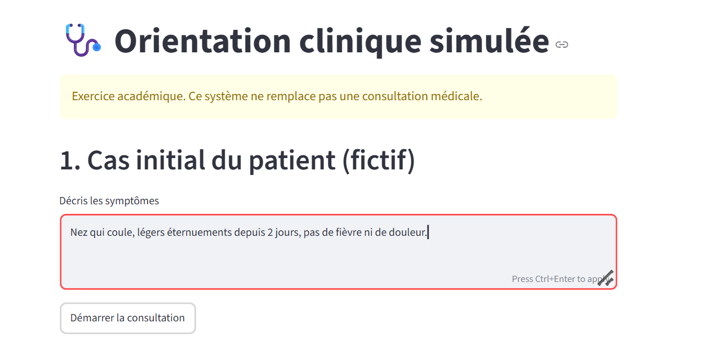
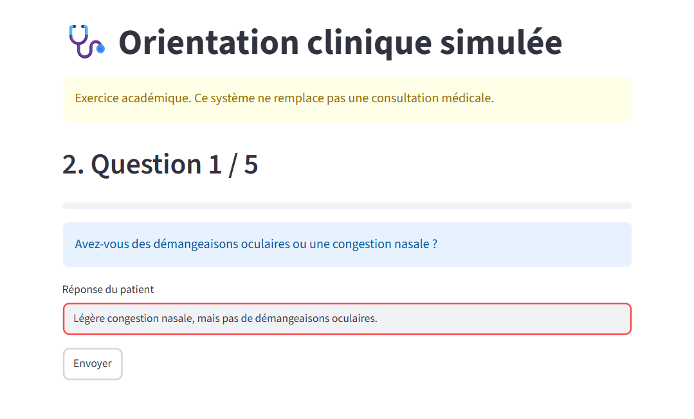
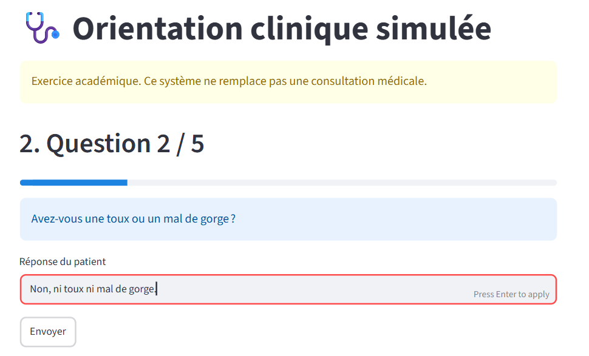
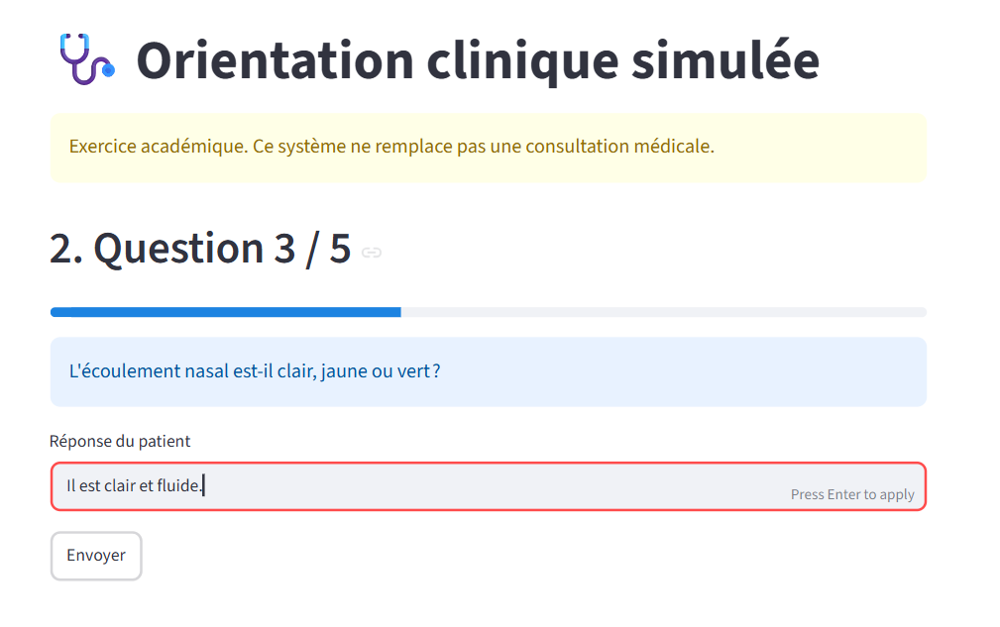
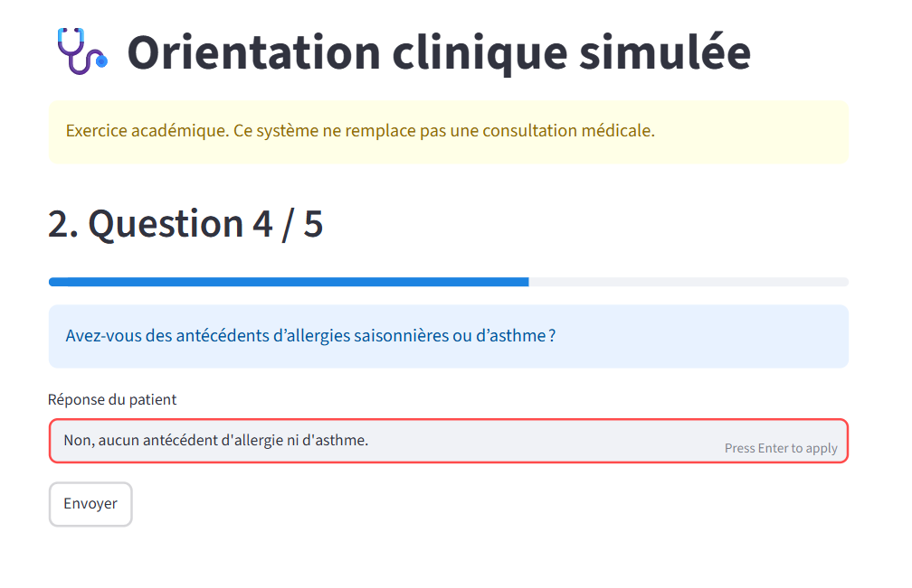
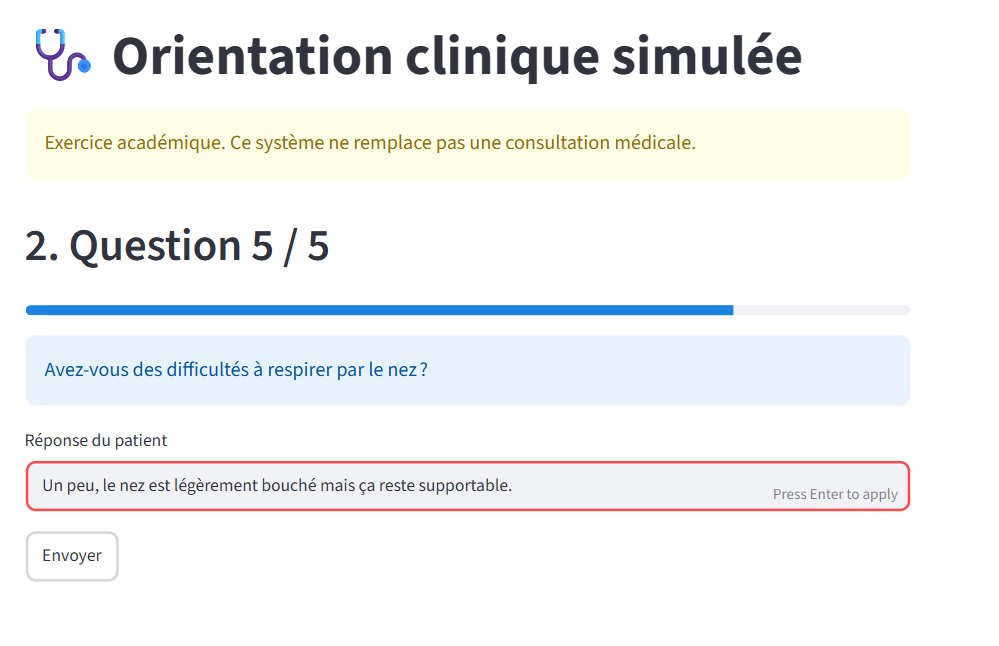
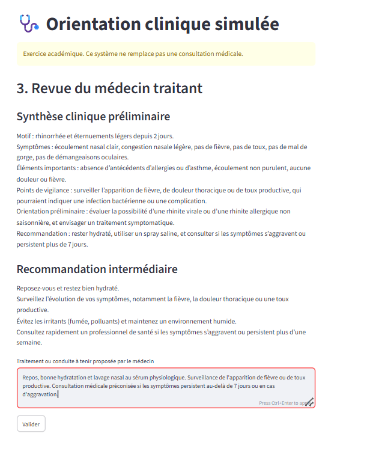
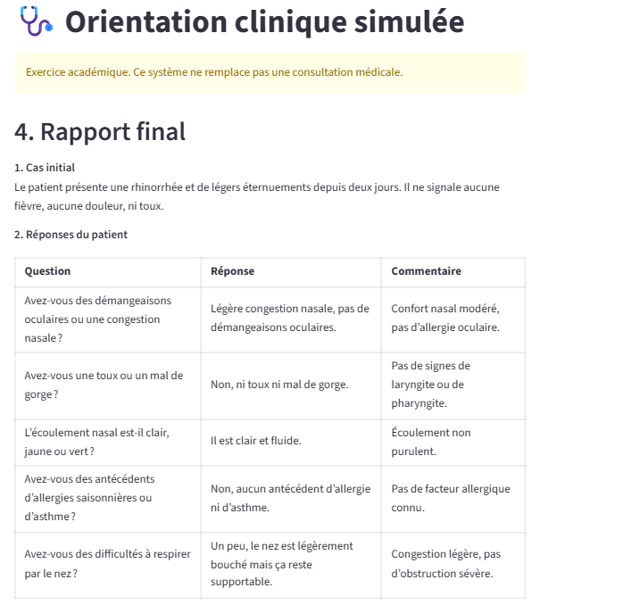
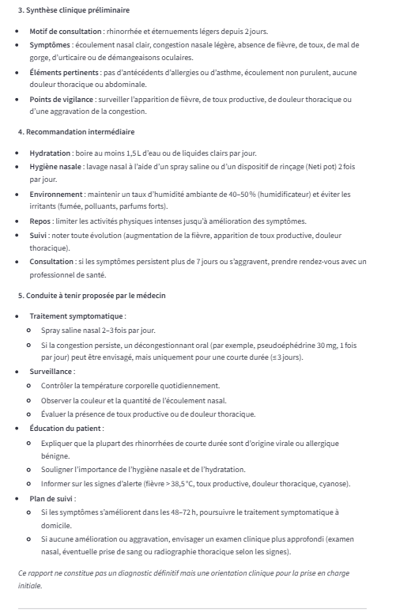
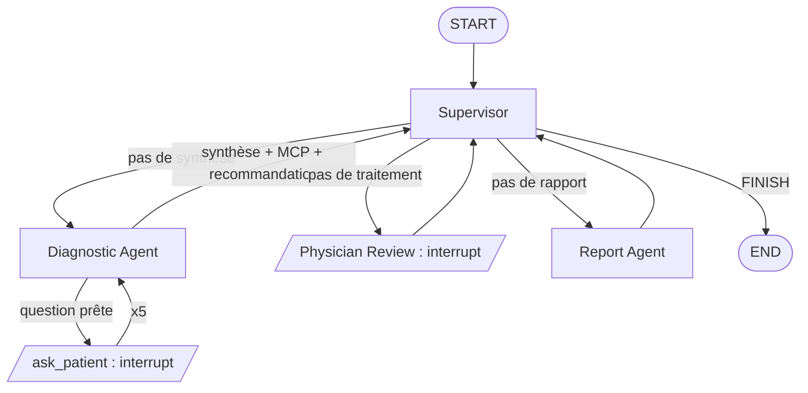

<div align="center">

# 🩺 MediGraph Diagnostics

### Système Multi-Agents d'Orientation et Diagnostic Clinique

Workflow **multi-agents** orchestré par **LangGraph**, avec **Human-in-the-Loop**, outil **MCP**, API **FastAPI** et interface **Streamlit**.


</div>

> [!WARNING]
> **Projet de démonstration.** MediGraph n'est pas un dispositif médical et ne fournit aucun diagnostic définitif : il produit une *orientation clinique préliminaire* sur des patients **fictifs**.
> *Ce système ne remplace pas une consultation médicale.*

---

## ✨ Aperçu

MediGraph simule le parcours d'une consultation, de la description des symptômes jusqu'au rapport final, en confiant chaque étape à un agent spécialisé.

1. 🧑‍⚕️ Un **patient fictif** décrit son cas.
2. 🤖 Le **Diagnostic Agent** lui pose **5 questions successives** et en tire une **synthèse clinique préliminaire**.
3. 🚨 Un **outil MCP** repère d'éventuels signaux d'alerte (*red flags*).
4. 💡 Le système propose une **recommandation intermédiaire** prudente (repos, hydratation, surveillance, consultation rapide en cas d'aggravation).
5. 👨‍⚕️ Un **médecin** valide et saisit la conduite à tenir (**Human-in-the-Loop**).
6. 📄 Le **Report Agent** génère un **rapport final structuré**.

Le tout est piloté par un **Supervisor** qui décide de l'étape suivante à partir de l'état partagé.

## 🎯 Points forts

| | |
|---|---|
| 🧠 **Orchestration multi-agents** | Un Supervisor, un agent de diagnostic, un agent de rapport et une étape de revue médicale, reliés dans un graphe LangGraph. |
| 🔁 **Human-in-the-Loop réel** | Le graphe se met en pause avec `interrupt()` (patient, puis médecin) et reprend avec `Command(resume=...)`. |
| 🔌 **Intégration MCP** | L'outil `check_red_flags` est exposé par un vrai serveur MCP et consommé par l'agent via un client dédié. |
| 🗂️ **État partagé typé** | Cas, 5 réponses, synthèse, recommandation, traitement et rapport circulent dans un `State` commun. |
| 🌐 **API + interface** | API FastAPI documentée (Swagger) et interface Streamlit en 4 écrans. |
| 🧪 **Testable sans clé** | Tests automatisés avec un faux LLM : aucune clé ni connexion nécessaire. |
| 🔍 **Débogable** | Graphe visualisable et transitions observables dans LangGraph Studio. |
| 🐳 **Déployable** | Lancement complet avec Docker Compose. |

## 🖼️ Démonstration

Scénario complet sur un cas bénin (rhinite) : cas initial, 5 questions, revue du médecin, rapport final.

<p align="center">
  
  <br><em>1. Saisie du cas initial (patient fictif)</em>
</p>

<details>
<summary><b>2. Les 5 questions au patient</b> (le graphe se met en pause à chaque question)</summary>
<br>
<p align="center">
  <br><br>
  <br><br>
  <br><br>
  <br><br>
  
</p>
</details>

<p align="center">
  
  <br><em>3. Revue du médecin traitant (Human-in-the-Loop)</em>
</p>

<p align="center">
  
  
  <br><em>4. Rapport final structuré</em>
</p>

## 🏗️ Architecture



| Élément | Rôle |
|---|---|
| `state.py` | État partagé (cas, 5 réponses, synthèse, recommandation, traitement, rapport) |
| `nodes/supervisor.py` | Orchestrateur : lit le State, écrit `next` |
| `nodes/diagnostic_agent.py` | Génère les questions, puis la synthèse préliminaire (LLM Groq) |
| `nodes/ask_patient.py` + `tools/patient_tools.py` | Tool `ask_patient` : `interrupt()` jusqu'à la réponse du patient |
| `nodes/physician_review.py` | Human-in-the-Loop : le médecin saisit la conduite à tenir |
| `nodes/report_agent.py` | Rapport final (mention obligatoire ajoutée par le code) |
| `tools/care_tools.py` | Tool `recommend_interim_care` |
| `mcp_server/server.py` + `tools/mcp_client.py` | Outil **MCP** `check_red_flags` (signaux d'alerte) |
| `api.py` | API FastAPI |
| `frontend/app.py` | Interface Streamlit (4 écrans) |

**Pause et reprise.** L'interruption utilise `interrupt()` et `Command(resume=...)` avec un checkpointer (`MemorySaver`) : le graphe se met en pause, attend la réponse du patient ou du médecin, puis reprend avec la valeur envoyée par l'API.

## 🧰 Stack technique

- **Orchestration** : LangGraph, LangChain
- **LLM** : Groq
- **Outils agents** : MCP (Model Context Protocol)
- **Backend** : Python, FastAPI, Uvicorn
- **Frontend** : Streamlit
- **Tests** : pytest (faux LLM)
- **Conteneurisation** : Docker, Docker Compose

## 🚀 Installation

```bash
python -m venv .venv
source .venv/bin/activate        # Windows : .venv\Scripts\activate
pip install -r backend/requirements.txt -r frontend/requirements.txt
cp .env.example .env             # Windows : copy .env.example .env
```

Renseigne ensuite `GROQ_API_KEY` dans le fichier `.env` (clé gratuite à créer sur [console.groq.com](https://console.groq.com)).

## ▶️ Lancement local

```bash
# Terminal 1 : API
cd backend && uvicorn app.api:app --reload

# Terminal 2 : interface
cd frontend && streamlit run app.py
```

- API et documentation Swagger : http://localhost:8000/docs
- Interface : http://localhost:8501

## 🔍 LangGraph Studio

```bash
pip install -U "langgraph-cli[inmem]"
cd backend && langgraph dev
```

Le graphe `medical` apparaît dans Studio : on y voit les transitions entre nœuds, les états intermédiaires et les deux interruptions (patient, médecin).

## 🐳 Docker

```bash
docker compose up --build
```

## 🧪 Tests

```bash
cd backend && pytest
```

Les tests utilisent un faux LLM : aucune clé ni connexion nécessaire (sauf `test_mcp.py`, qui lance le vrai serveur MCP en local).

## 📡 API

| Méthode | Endpoint | Description |
|---|---|---|
| `POST` | `/sessions/start` | Crée une session et renvoie un `thread_id` |
| `POST` | `/consultation/start` | Démarre une consultation avec le cas du patient |
| `POST` | `/consultation/resume` | Reprend le graphe avec la réponse du patient ou du médecin |
| `GET` | `/consultation/{thread_id}` | État courant de la consultation |
| `GET` | `/consultation/{thread_id}/report` | Rapport final |
| `GET` | `/health` | Vérification de l'état du service |

```bash
curl -X POST localhost:8000/sessions/start
curl -X POST localhost:8000/consultation/start -H "Content-Type: application/json" \
  -d '{"thread_id":"<id>","patient_case":"Toux et fièvre depuis 2 jours"}'
curl -X POST localhost:8000/consultation/resume -H "Content-Type: application/json" \
  -d '{"thread_id":"<id>","value":"Depuis 2 jours"}'
```

> Sous PowerShell, utilise `curl.exe` et écris la commande sur une seule ligne.

## ⚠️ Limites techniques

- **Persistance éphémère (`MemorySaver`)** : Stockage en mémoire vive ; les consultations sont réinitialisées au redémarrage de l'API.
- **Tolérance aux pannes MCP** : Si le serveur MCP est indisponible, le workflow se poursuit sans blocage en consignant un avertissement (*warning*) dans les logs.
- **Détection par règles** : L'outil d'alerte s'appuie sur une correspondance de mots-clés (`mcp_server/data/red_flags.json`).
- **Périmètre d'usage** : Prototype de démonstration technique d'orientation clinique, sans valeur de diagnostic médical.

## 👩‍💻 Auteure

**Hafsa El BZOUR** — AI & Software Engineer

*Spécialisée en LLMs, orchestration d'agents intelligents (LangChain/LangGraph) et architectures FastAPI.*
